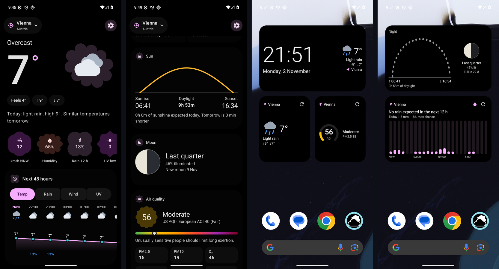
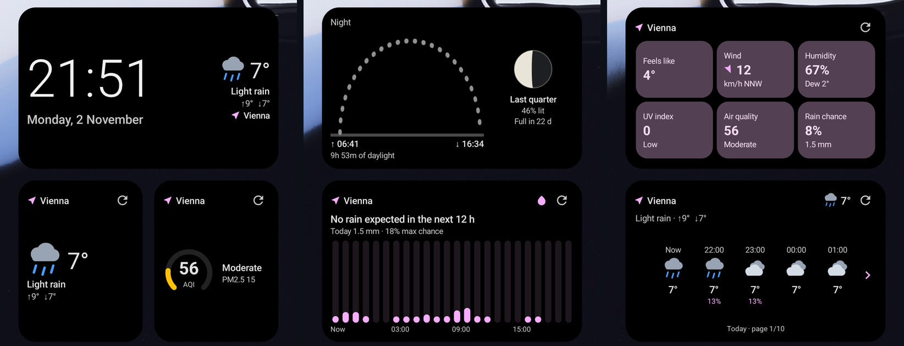
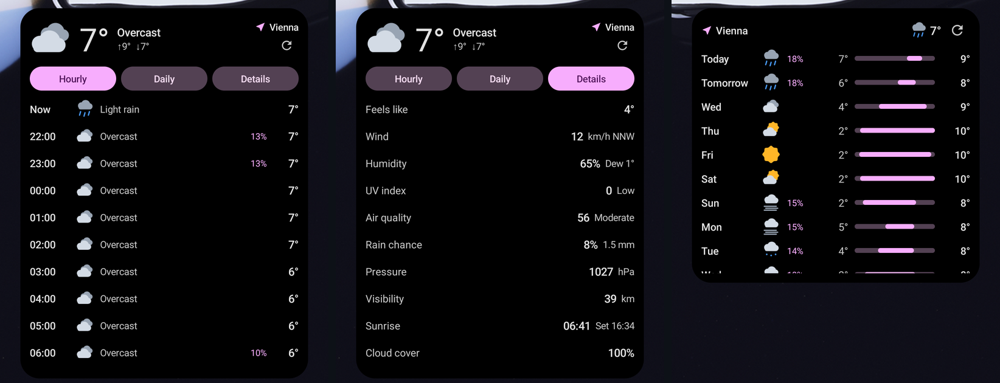
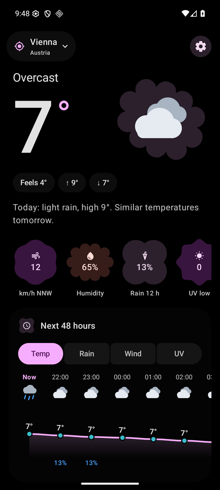
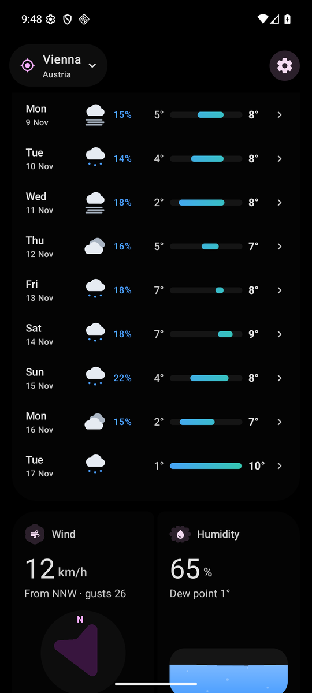
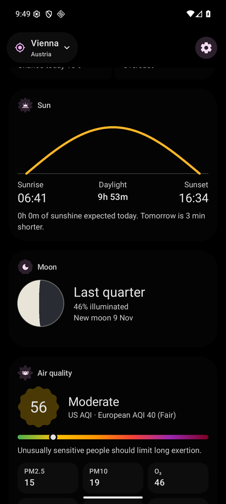
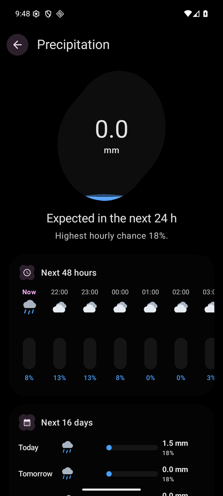
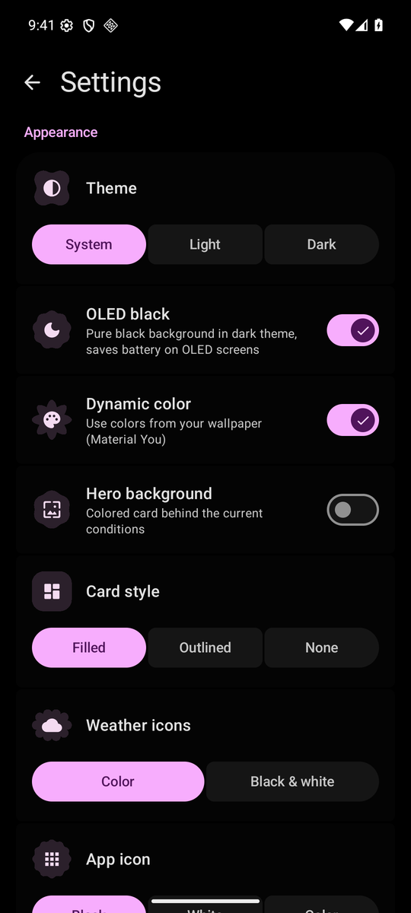

<div align="center">


# Expressive Weather

**A beautiful, private, open weather app for Android, built with Material 3 Expressive.**
No ads, no tracking, no API keys, no Google Play Services.

[](https://github.com/visiuun/expressive-weather/releases/latest)
[](#compatibility)
[](LICENSE)
[](https://github.com/visiuun/expressive-weather/actions)



### [⬇ Download the latest APK](https://github.com/visiuun/expressive-weather/releases/latest)

</div>

---

## Widgets

Nine home screen widgets. All of them resize, follow your wallpaper colours (Material You) and dark mode, and many are interactive right on the home screen.




| Widget | Size | What it does |
|---|---|---|
| **Now** | 2×1 to 5×5 | Current conditions. Shrinks to a slim pill, grows to add an hourly strip |
| **Clock & weather** | 4×2 | Big clock and date beside the weather. Tap the time for alarms, the date for your calendar |
| **Hourly** | 4×2 | The next 48 hours. Use the ‹ › arrows to page through them |
| **16-day forecast** | 4×3 | Scrollable daily list with temperature range bars. Tap a day to open it |
| **Forecast hub** | 4×4 | Switch between **Hourly**, **Daily** and **Details** tabs without opening the app |
| **Details** | 4×2 | Feels like, wind with a direction arrow, humidity, UV, air quality, rain, pressure, visibility… More tiles appear as you enlarge it |
| **Rain** | 4×2 | Plain-language nowcast ("Rain starting in ~30 min") and a chart of rain chance for the next 12 or 24 hours |
| **Sun & moon** | 4×2 | The sun's position between sunrise and sunset, and the moon phase |
| **Air quality** | 2×2 | AQI gauge, fine particles and the strongest pollen |

## The app

<table>
  <tr>
    <td></td>
    <td></td>
    <td></td>
    <td></td>
    <td></td>
  </tr>
  <tr align="center">
    <td>Now & next 48 h</td>
    <td>16 days & tiles</td>
    <td>Sun, moon, air</td>
    <td>Detail screens</td>
    <td>Settings</td>
  </tr>
</table>

- **Current conditions** with a plain-language summary ("Today: light rain, high 9°. Similar temperatures tomorrow.")
- **48-hour forecast** with temperature, rain, wind and UV charts
- **16-day forecast**. Tap any day for its hour-by-hour breakdown
- **A detail screen for every stat**: wind (a compass that turns with your phone), humidity (water that sloshes when you tilt the phone), UV, feels like, pressure, visibility, precipitation, cloud cover, sun, moon, air quality and pollen
- **15-minute rain nowcast** for the next few hours
- **Air quality** (US & European AQI, PM2.5, PM10, ozone…) and **pollen** for six plant types
- **Several locations**: your current location plus any number of saved places
- **Works offline**: the last forecast for each place is cached
- **Themes**: system, light, dark and **OLED black**, Material You dynamic colour, three card styles, colour or black & white icons, and three app icons
- **Units**: °C/°F, km/h, m/s, mph, knots, mm/in, hPa, inHg, mmHg, 12/24-hour clock
- **Automatic updates** straight from this repository's releases

## How to use

### Install

1. Open the **[latest release](https://github.com/visiuun/expressive-weather/releases/latest)** on your phone and download the `Expressive-Weather-x.y.z.apk` file.
2. Open the downloaded file. If Android asks, allow your browser or file manager to **install unknown apps**.
3. Tap **Install**.

### First start

- Tap **Use my location** and allow location access, or **Search for a place** to pick a city by name.
- Tap the place name at the top to add more places, switch between them or remove them.
- Pull down to refresh. Tap any tile or chart to open its detail screen.
- The gear icon opens **Settings** (theme, OLED black, units, app icon, widgets and updates).

### Add widgets

- **From the app:** *Settings → Widgets*, then tap the widget you want and confirm **Add to home screen**.
- **From the home screen:** touch and hold an empty spot, choose **Widgets**, find **Expressive Weather** and drag a widget onto the screen.

Once a widget is placed:

| Tap… | …to |
|---|---|
| the ⟳ button | refresh every widget now |
| the place name | switch **this widget** to your next saved place (each widget can show a different place) |
| **Hourly / Daily / Details** (Forecast hub) | switch tabs |
| **‹ ›** (Hourly) | page through the next 48 hours |
| a day, tile or chart | open the app on that day or detail screen |
| the clock / date (Clock & weather) | open your alarms / calendar |

Touch and hold a widget, then drag its handles to resize it. Layouts adapt from a slim pill up to a full-screen dashboard. Widgets refresh by themselves about every 30 minutes when you're online, and immediately whenever the app loads new data.

### Updates

The app checks this repository's **Releases** when it starts (at most every 6 hours) and offers new versions in a dialog. Tap **Update** and Android will ask you to confirm the install. You can turn this off or check manually in *Settings → Updates*. The first time, Android asks you to allow Expressive Weather to install apps.

Nothing else is sent anywhere: the check is a single anonymous request to the public GitHub API.

## Privacy

- **No accounts, ads, analytics or trackers.**
- Your location is only used to request the forecast for those coordinates and to look up the place name.
- **No Google Play Services**: location uses Android's own `LocationManager`, so the app works on de-Googled ROMs such as GrapheneOS, LineageOS, CalyxOS and /e/OS.
- Network requests go only to:
  - [Open-Meteo](https://open-meteo.com) for forecasts, air quality and place search (free and open source, no API key)
  - [OpenStreetMap Nominatim](https://nominatim.openstreetmap.org) to turn your coordinates into a place name
  - [GitHub](https://github.com/visiuun/expressive-weather/releases) to check for updates (can be turned off)

## Compatibility

| | |
|---|---|
| **Android** | 7.0 (API 24) and newer, tested up to Android 16 |
| **Devices** | Phones, tablets and foldables (layouts adapt to wide screens) |
| **APK** | One universal APK. No native code, so it runs on every CPU (ARM, ARM64, x86, x86_64) |
| **Google services** | Not needed |
| **Widget previews** | Live previews in the widget picker on Android 15+ |

## Build it yourself

You need a **JDK 17 or newer**. Everything else (Gradle, the Android Gradle Plugin, libraries and the required Android SDK platform) is downloaded automatically on the first build.

```bash
git clone https://github.com/visiuun/expressive-weather.git
cd expressive-weather
./gradlew assembleRelease        # Windows: gradlew.bat assembleRelease
```

The APK ends up in `app/build/outputs/apk/release/`. Or open the folder in **Android Studio** and press *Run*.

If you don't already have the Android SDK, install [Android Studio](https://developer.android.com/studio) or the command-line tools once and point `ANDROID_HOME` (or `sdk.dir` in `local.properties`) at it. Gradle fetches the platform version it needs by itself.

<details>
<summary><b>Signing your own release builds</b></summary>

Without a key, release builds are signed with the debug key, which is fine for trying things out. To sign with your own key, create `keystore.properties` in the project root (it is git-ignored):

```properties
storeFile=app/release.jks
storePassword=your-store-password
keyAlias=your-alias
keyPassword=your-key-password
```

Or set the environment variables `SIGNING_STORE_FILE`, `SIGNING_STORE_PASSWORD`, `SIGNING_KEY_ALIAS` and `SIGNING_KEY_PASSWORD`.

Note: Android only installs an update over an existing app if both are signed with the same key. Builds you sign yourself can't update the official release, and vice versa.

</details>

<details>
<summary><b>Project structure</b></summary>

```
app/src/main/java/dev/vis/weather/
├── data/       Open-Meteo client & parsing, location, preferences, offline cache, self-updater
├── ui/         Jetpack Compose screens: main, day, metric details, locations, settings
│   ├── components/   charts, tiles, weather icons, compass, sensor effects
│   └── theme/        Material 3 Expressive theme, dynamic colour, OLED black
└── widget/     Jetpack Glance widgets, background refresh (WorkManager), widget art
```

Built with Kotlin, Jetpack Compose, Material 3 Expressive, Jetpack Glance and WorkManager. No other third-party libraries.

</details>

## Contributing

Bug reports, ideas and pull requests are welcome. Please [open an issue](https://github.com/visiuun/expressive-weather/issues) first for larger changes.

## Credits

- Weather and air-quality data by **[Open-Meteo.com](https://open-meteo.com)**, licensed [CC BY 4.0](https://creativecommons.org/licenses/by/4.0/), based on national weather services (DWD, NOAA, Météo-France, ECMWF and others) and Copernicus CAMS.
- Place names © **[OpenStreetMap](https://www.openstreetmap.org/copyright)** contributors, ODbL.
- Shapes, motion and colour from Google's **Material 3 Expressive**.

## License

**[CC BY-NC 4.0](LICENSE)**: you're free to use, change, fork and share this project for anything **non-commercial**, as long as you **credit it** with "Expressive Weather by visiuun" and a link to this repository, and say what you changed. Commercial use of any kind (selling it, paywalls, ads) is not allowed.

© 2026 visiuun
