<div align="center">


# Expressive Weather

**A beautiful, private, open weather app for Android, built with Material 3 Expressive.**
No ads, no tracking, no API keys, no Google Play Services.

[](https://github.com/visiuun/expressive-weather/releases/latest)
[](#compatibility)
[](LICENSE)
[](https://github.com/visiuun/expressive-weather/actions)

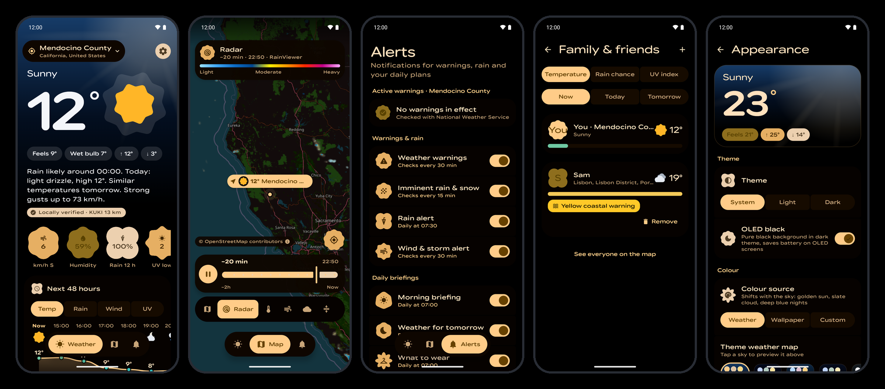

### [⬇ Download the latest APK](https://github.com/visiuun/expressive-weather/releases/latest)

</div>

---

## Widgets

Ten home screen widgets. All of them resize, follow your wallpaper colours (Material You) and dark mode, and many are interactive right on the home screen.

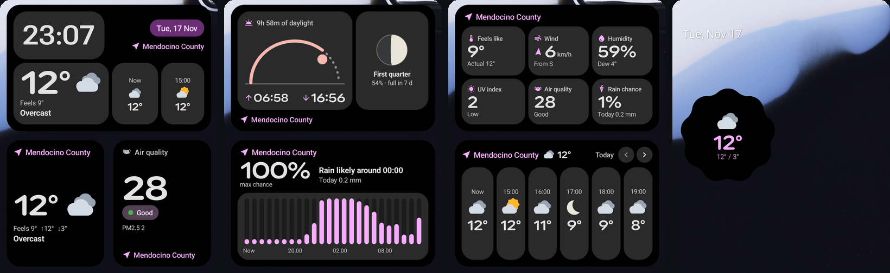
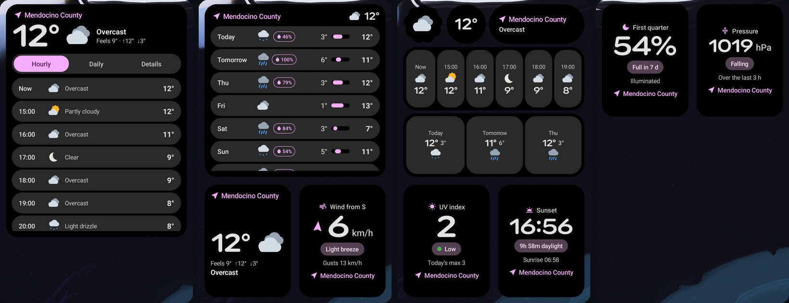

| Widget | Size | What it does |
|---|---|---|
| **Now** | 2×1 to 5×5 | Current conditions. Shrinks to a slim pill, grows to add an hourly strip |
| **Clock & weather** | 4×2 | Big clock and date beside the weather. Tap the time for alarms, the date for your calendar |
| **Hourly** | 4×2 | The next 48 hours. Use the ‹ › arrows to page through them |
| **16-day forecast** | 4×3 | Scrollable daily list with temperature range bars. Tap a day to open it |
| **Forecast hub** | 4×4 | Switch between **Hourly**, **Daily** and **Details** tabs without opening the app |
| **Details** | 4×2 | Feels like, wind with a direction arrow, humidity, UV, air quality, rain, pressure, visibility… More tiles appear as you enlarge it |
| **Rain** | 4×2 | Plain-language nowcast ("Rain starting in ~30 min") and a chart of rain chance for the next 12 or 24 hours |
| **Sun & moon** | 4×2 | The sun's position between sunrise and sunset, and the moon phase |
| **Air quality** | 2×2 | AQI gauge, fine particles and the strongest pollen |
| **Weather shape** | 1×1 and up (2×2 default) | The temperature inside one of 28 Material 3 Expressive shapes (cookie, clover, sunny, gem, ghost…). Pick the shape, colours and transparency with a live preview |

## The app

<table>
  <tr>
    <td>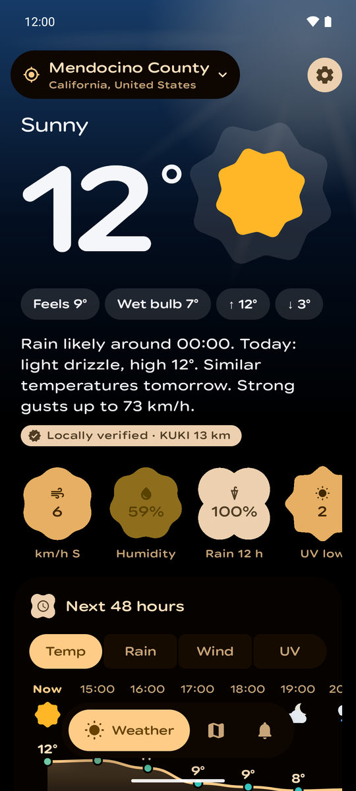</td>
    <td>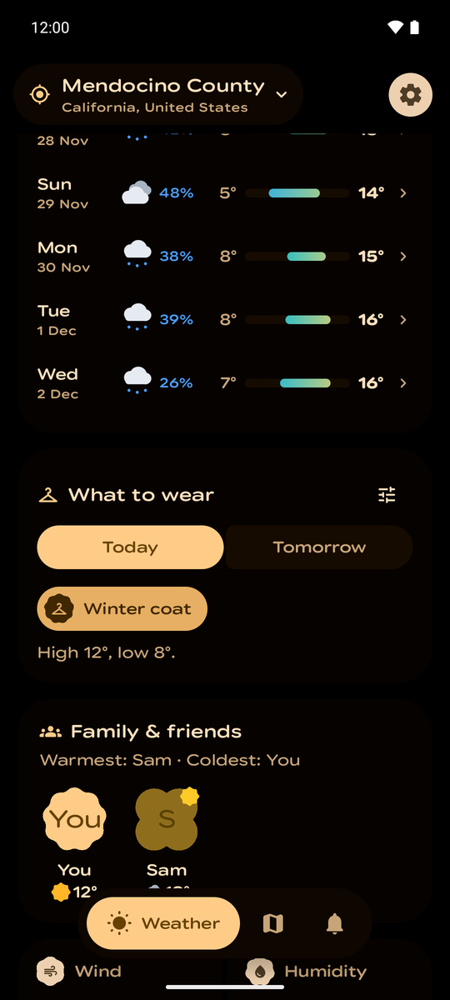</td>
    <td>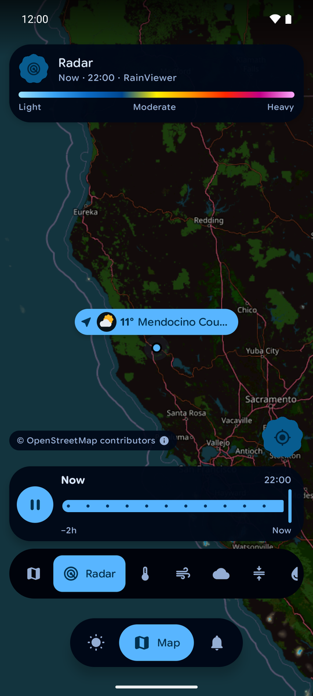</td>
    <td>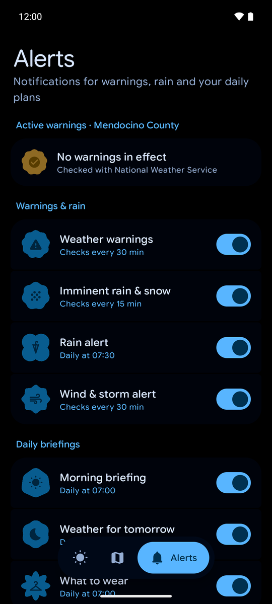</td>
  </tr>
  <tr align="center">
    <td>Live sky & forecast</td>
    <td>What to wear & friends</td>
    <td>Radar & weather map</td>
    <td>Alerts</td>
  </tr>
  <tr>
    <td>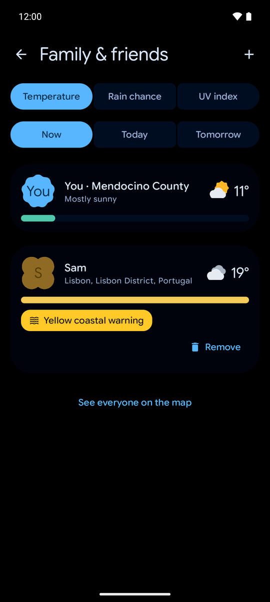</td>
    <td>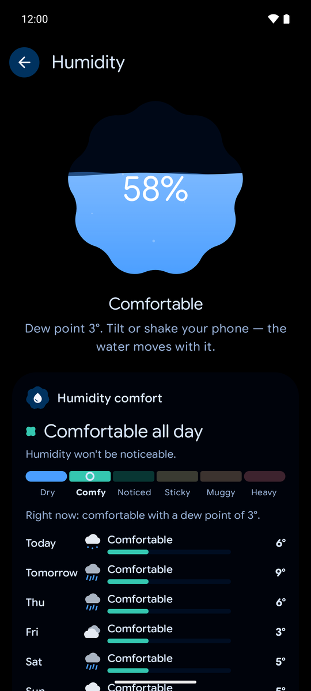</td>
    <td>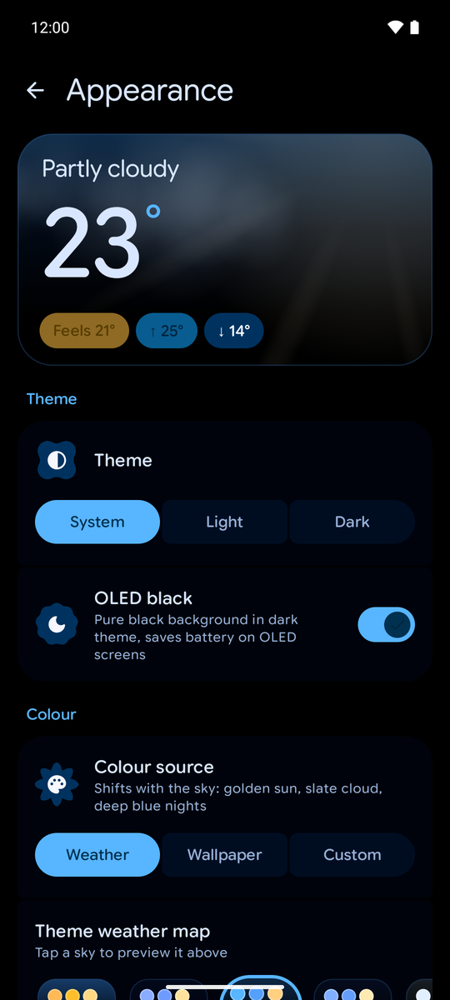</td>
    <td>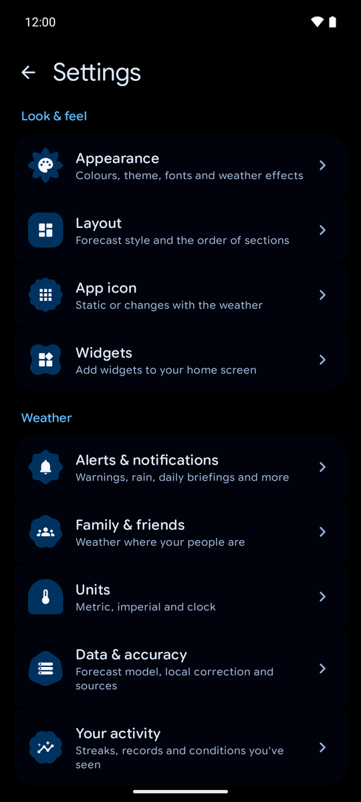</td>
  </tr>
  <tr align="center">
    <td>Family & friends</td>
    <td>Detail screens</td>
    <td>Appearance</td>
    <td>Settings</td>
  </tr>
</table>

- **A sky that changes with the weather**: the theme shifts with the conditions (golden on a clear afternoon, slate under cloud, charcoal in a storm, deep blue at night), with **live effects** behind the forecast: rain angled by the wind, snow, hail, fog, lightning, sun rays and twinkling stars. Subtle **haptics** match the weather
- **Current conditions** with a plain-language summary, compared with yesterday, and a **"Locally verified" correction** from the nearest airport weather station (METAR). Optionally show the **wet-bulb temperature** next to "feels like"
- **48-hour forecast** as a graph, compact list or cards, and up to **16 days**. Tap any day for its hour-by-hour breakdown
- **Choose your forecast model** or let Auto pick the best high-resolution regional model (ICON, AROME, HARMONIE, HRRR, UKMO, MET Nordic, GEM, JMA…)
- **A detail screen for every stat**: wind (a compass that turns with your phone), humidity (water that sloshes when you tilt the phone) with **cooling comfort** (wet bulb), UV with the hours you need protection, pressure trend with a headache note, visibility, precipitation (today's total, rain/snow/ice), cloud cover, **fire weather index**, sun (first and last light, solar noon, daylight change, solstices), moon (rise, set, next full moon, **stargazing tonight**), air quality (US and European AQI against WHO limits) and pollen
- **Sea conditions** on the coast: waves, swell, wave period, sea temperature with wetsuit advice, currents and tides, with guidance for swimming, surfing and sailing
- **Weather map**: animated rain radar plus temperature, wind, cloud, pressure and precipitation layers with a 48-hour time slider, and active hurricanes and tropical storms
- **Official weather warnings** (yellow, amber, red) for the US, Canada, Germany and 36 more European countries, on the main screen and as notifications
- **What to wear**: clothing and carry-item advice for your day, based on your commute and how easily you feel the cold
- **Family & friends**: see the weather where your people live, compare temperature, rain and UV, and get their warnings. Pick them from your contacts without giving the app contacts access
- **15-minute rain nowcast**, **air quality** and **pollen** for six plant types
- **Several locations**, and **works offline**: the last forecast for each place is cached
- **Make it yours**: weather, wallpaper (Material You) or any custom colour in three palette styles; system, light, dark and **OLED black**; fonts in Default, Chunky or Tall with sharp or rounded edges, plus **Lexend** and **OpenDyslexic** for readability; reorder or hide every section of the main screen
- **A minimal app icon** (the Material 3 Expressive sun shape in white on black), or one that **changes with the weather**, or any of 12 icons; plus app shortcuts for the map, alerts and friends
- **Units**: °C/°F, km/h, m/s, mph, knots, mm/in, hPa, inHg, mmHg, km/mi, 12/24-hour clock
- **Your activity**: check-in streaks, the hottest and coldest weather you've seen and the conditions you've collected, kept only on your phone
- **Automatic updates** straight from this repository's releases
- …and a few secrets. Try typing a few unusual words into the place search.

## Alerts & notifications

Everything is optional and set up in the **Alerts** tab. Each alert has its own screen with its settings, a plain explanation of how it works and a **Send a test notification** button.

| Alert | What it does |
|---|---|
| **Weather warnings** | Official warnings from NWS (US), Environment Canada, Deutscher Wetterdienst and MeteoAlarm (36 more European countries). Choose the minimum level and whether to include all saved places. You're notified once per warning and again if it's upgraded |
| **Imminent rain & snow** | A heads-up minutes before rain or snow starts, with a **live countdown** and a coloured intensity timeline that keeps updating until it starts, then says when it will stop. Shown as a **Live Update** in the status bar on Android 16 |
| **Rain alert** | Rain likely in the next few hours, checked once at a set time or all day during the hours you choose |
| **Wind & storm alert** | Gusts above your limit or thunderstorms in the next hours, even without an official warning |
| **Morning briefing** | Your day's weather each morning, compared with yesterday |
| **Weather for tomorrow** | An evening summary of tomorrow |
| **What to wear** | Daily clothing advice, using a work location for office hours if you set one |
| **Dangerous wet bulb** | Warns as soon as heat and humidity are forecast to reach a dangerous wet-bulb temperature, even during quiet hours |
| **Frost, UV, air quality, pollen** | Each with its own threshold (pollen per allergen: trees, grass, weeds) |
| **Hay fever tablet reminder** | A daily reminder, optionally only on high-pollen days |
| **Pressure drop** | Rapid falls in barometric pressure, which can trigger headaches for some people |
| **Family & friends** | Warnings at the places of the people in your list |
| **Status bar weather** | The current temperature always in your status bar, with today's forecast in the notification |

Plus **quiet hours** (alerts arrive silently overnight, but amber and red warnings still sound), a history of recent notifications, exact timing when Android allows it, and separate notification channels so you can fine-tune sounds in Android settings.

## How to use

### Install

1. Open the **[latest release](https://github.com/visiuun/expressive-weather/releases/latest)** on your phone and download the `Expressive-Weather-x.y.z.apk` file.
2. Open the downloaded file. If Android asks, allow your browser or file manager to **install unknown apps**.
3. Tap **Install**.

### First start

- Tap **Use my location** and allow location access, or **Search for a place** to pick a city by name.
- Tap the place name at the top to add more places, switch between them or remove them.
- Pull down to refresh. Tap any tile or chart to open its detail screen.
- The gear icon opens **Settings** (theme, OLED black, units, app icon, widgets and updates).

### Add widgets

- **From the app:** *Settings → Widgets*, then tap the widget you want and confirm **Add to home screen**.
- **From the home screen:** touch and hold an empty spot, choose **Widgets**, find **Expressive Weather** and drag a widget onto the screen.

Once a widget is placed:

| Tap… | …to |
|---|---|
| the ⟳ button | refresh every widget now |
| the place name | switch **this widget** to your next saved place (each widget can show a different place) |
| **Hourly / Daily / Details** (Forecast hub) | switch tabs |
| **‹ ›** (Hourly) | page through the next 48 hours |
| a day, tile or chart | open the app on that day or detail screen |
| the clock / date (Clock & weather) | open your alarms / calendar |

Touch and hold a widget, then drag its handles to resize it. Layouts adapt from a slim pill up to a full-screen dashboard. Widgets refresh by themselves about every 30 minutes when you're online, and immediately whenever the app loads new data.

### Updates

The app checks this repository's **Releases** when it starts (at most every 6 hours) and offers new versions in a dialog. Tap **Update** and Android will ask you to confirm the install. You can turn this off or check manually in *Settings → Updates*. The first time, Android asks you to allow Expressive Weather to install apps.

Nothing else is sent anywhere: the check is a single anonymous request to the public GitHub API.

## Privacy

- **No accounts, ads, analytics or trackers.**
- Your location is only used to request the forecast for those coordinates and to look up the place name.
- **No Google Play Services**: location uses Android's own `LocationManager`, so the app works on de-Googled ROMs such as GrapheneOS, LineageOS, CalyxOS and /e/OS.
- Your contacts stay private: Family & friends uses the system contact picker, so the app never gets access to your contacts. Only the name and photo of the people you pick are kept, on your phone.
- Network requests go only to:
  - [Open-Meteo](https://open-meteo.com) for forecasts, air quality, marine data and place search (free and open source, no API key)
  - [OpenStreetMap Nominatim](https://nominatim.openstreetmap.org) to turn coordinates into a place name and region
  - [aviationweather.gov](https://aviationweather.gov) (NOAA) for the nearest station observation, when local correction is on (only a rough area is sent)
  - The national warning services: [NWS](https://www.weather.gov), [Environment Canada](https://weather.gc.ca), [Bright Sky](https://brightsky.dev) for Deutscher Wetterdienst, [MeteoAlarm](https://meteoalarm.org)
  - [RainViewer](https://www.rainviewer.com) for radar, [OpenStreetMap](https://www.openstreetmap.org) map tiles, and the [NOAA National Hurricane Center](https://www.nhc.noaa.gov) on the map
  - [GitHub](https://github.com/visiuun/expressive-weather/releases) to check for updates (can be turned off)

## Compatibility

| | |
|---|---|
| **Android** | 7.0 (API 24) and newer, tested up to Android 16 |
| **Devices** | Phones, tablets and foldables (layouts adapt to wide screens) |
| **APK** | One universal APK for every CPU type (ARM, ARM64, x86, x86_64) |
| **Google services** | Not needed |
| **Widget previews** | Live previews in the widget picker on Android 15+ |

## Build it yourself

You need a **JDK 17 or newer**. Everything else (Gradle, the Android Gradle Plugin, libraries and the required Android SDK platform) is downloaded automatically on the first build.

```bash
git clone https://github.com/visiuun/expressive-weather.git
cd expressive-weather
./gradlew assembleRelease        # Windows: gradlew.bat assembleRelease
```

The APK ends up in `app/build/outputs/apk/release/`. Or open the folder in **Android Studio** and press *Run*.

If you don't already have the Android SDK, install [Android Studio](https://developer.android.com/studio) or the command-line tools once and point `ANDROID_HOME` (or `sdk.dir` in `local.properties`) at it. Gradle fetches the platform version it needs by itself.

<details>
<summary><b>Signing your own release builds</b></summary>

Without a key, release builds are signed with the debug key, which is fine for trying things out. To sign with your own key, create `keystore.properties` in the project root (it is git-ignored):

```properties
storeFile=app/release.jks
storePassword=your-store-password
keyAlias=your-alias
keyPassword=your-key-password
```

Or set the environment variables `SIGNING_STORE_FILE`, `SIGNING_STORE_PASSWORD`, `SIGNING_KEY_ALIAS` and `SIGNING_KEY_PASSWORD`.

Note: Android only installs an update over an existing app if both are signed with the same key. Builds you sign yourself can't update the official release, and vice versa.

</details>

<details>
<summary><b>Project structure</b></summary>

```
app/src/main/java/dev/vis/weather/
├── alerts/     warnings providers, alert engine, notifications, scheduling (WorkManager + exact alarms)
├── data/       Open-Meteo client & parsing, models, marine, METAR correction, astronomy, friends, cache
├── ui/         Jetpack Compose screens: main, day, metric details, alerts, map, friends, settings
│   ├── components/   charts, tiles, weather icons, compass, sensor effects, settings rows
│   ├── detail/       sea, sun & moon and index detail screens
│   ├── effects/      live weather sky and haptics
│   ├── map/          tile map, radar and model layers
│   └── theme/        weather-reactive colour, typography, secret themes
└── widget/     Jetpack Glance widgets, shape widget, background refresh, widget art
```

Built with Kotlin, Jetpack Compose, Material 3 Expressive, Jetpack Glance and WorkManager. The only other library is [material-color-utilities](https://github.com/jordond/MaterialKolor) for colour schemes.

</details>

## Contributing

Bug reports, ideas and pull requests are welcome. Please [open an issue](https://github.com/visiuun/expressive-weather/issues) first for larger changes.

## Credits

- Weather and air-quality data by **[Open-Meteo.com](https://open-meteo.com)**, licensed [CC BY 4.0](https://creativecommons.org/licenses/by/4.0/), based on national weather services (DWD, NOAA, Météo-France, ECMWF and others) and Copernicus CAMS.
- Place names and map tiles © **[OpenStreetMap](https://www.openstreetmap.org/copyright)** contributors, ODbL.
- Weather warnings from the **National Weather Service**, **Environment and Climate Change Canada**, **Deutscher Wetterdienst** (via [Bright Sky](https://brightsky.dev)) and **[MeteoAlarm](https://meteoalarm.org)/EUMETNET** (CC BY 4.0). Station observations from **NOAA aviationweather.gov**. Radar by **[RainViewer](https://www.rainviewer.com)**. Storms from the **NOAA National Hurricane Center**.
- Fonts: **Google Sans Flex** and **Lexend** (SIL Open Font License), **OpenDyslexic** (SIL OFL).
- Shapes, motion and colour from Google's **Material 3 Expressive**.

## License

**[CC BY-NC 4.0](LICENSE)**: you're free to use, change, fork and share this project for anything **non-commercial**, as long as you **credit it** with "Expressive Weather by visiuun" and a link to this repository, and say what you changed. Commercial use of any kind (selling it, paywalls, ads) is not allowed.

© 2026 visiuun
